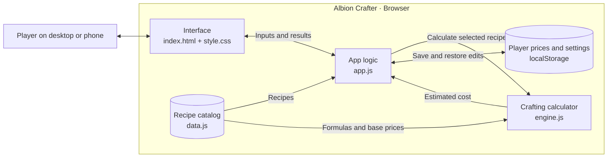

# Crafting Calculator

> One line: This is an app that helps do the math for certain crafting recipes in games without the need for me to use a calculator and paper in order to figure out the price and materials needed.

**Author:** Reimon Musaj · **Course:** CMP 464/343 Product 1 · **Last updated:** [date]

---

## 1. About Me (the User)

*Who am I in the context of this problem? What roles am I playing (student, employee, parent, athlete, gamer…)?*

I’m a student whose biggest hobby is gaming, but sometimes I do not have the time to waste on doing more unnecessary mental work just to figure out what it will cost me in terms of materials and in-game currency to be able to craft a better piece of equipment, so I would love a way to at least automate the math behind it.

**The last 3 times this happened:**
*Real, recent moments. For each: when and where, what went wrong, what it cost, what you did.*

1. 3 months ago, I was playing this game called Albion, and because of my miscalculation while doing the math for the cost I would have to pay, I ended up paying more than I profited.
2. 
3. 

**What it costs me:**
*Be specific. How often, how much?*

- ⏱️ Time: It cost me a few hours of my day to regrind for the money I had lost.
- 💸 Money: No actual real money cost, but a huge waste of in-game currency that I had to regrind for.
- 🔋 Energy: It wasted some of my time and energy doing things I didn't want to redo again.
- 🙂 Joy: Same as energy because I was forced to regrind more content I didn't want to do; it was quite boring and annoying.

---

## 2. Problem Statement

**Gut check:**

I need a crafting calculator because manually tracking nested recipes and material quantities is slow, confusing, and prone to mistakes. 

**Five Whys:**
1. Why do I need a crafting calculator?
Because I want to know exactly which materials I need to craft an item and their associated total cost. 

2. Why is that difficult without a calculator?
Because many items require intermediate components, each with its own recipe.

3. Why are nested recipes a problem?
Because players must repeatedly calculate quantities, combine shared materials, and account for recipe output sizes. 

4. Why do those calculations matter?
Because mistakes lead to extra farming trips, wasted resources, and interrupted gameplay. 

5. Why is avoiding that important?
Because players want to spend more time progressing and creating—and less time doing arithmetic or consulting multiple guides. 

When I prepare to craft a complex item in a game,
I struggle to determine the total raw materials required across all its component recipes,
which costs me 10–30 minutes of manual calculation and often causes extra gathering trips.
This happens because crafting recipes contain multiple layers, shared ingredients, different batch sizes, and materials I may already own.
Right now I search guides and calculate each recipe by hand, but this is slow, error-prone, and difficult to update when my inventory changes.

I’ll know this is solved when: I can select an item and quantity, account for materials I already own, and receive an accurate gathering list in under one minute.

---

## 3. Existing Solutions

| What I use or tried | What it does well | Why it falls short *for me* |
|Online guides on how to efficiently craft | It helps get a general idea of how to do the math efficiently for all materials needed  | Harder to replicate and reuse previously done math when the batch size changes |
|Calculators for a specific game | It solves the problem of doing the math by hand | More often than not, it only supports one game |

**The gap:** *In one sentence, what's still missing for me?*

What is still missing for me is the versatility of being able to just select a game and a list of different recipes that I can use shows up without me having to go and look for a guide on how to do it effectively by hand or have to search and hope that someone else has made something to help with it for the game I'm playing at the time.

---

## 4. Features & Benefits

*Every feature should move me toward my "solved when" line.*

| Feature (what it does) | Benefit (how my life gets better) | MVP or Later? |
|Select a craftable item and desired quantity | I can define my crafting goal quickly and accurately | MVP |

|Combine duplicate ingredients from every recipe layer  | I get one clear gathering list without repeated materials  | MVP  |

| Search and filter the recipe list  | I can find my target item in seconds  | MVP  |

| Support alternative recipes  | I can choose the most convenient or efficient crafting route  | Later  |

## 5. Tech Stack

### Front end

- **Surface:** A responsive web app for desktop and mobile browsers.
- **Tools:** HTML and CSS for the interface, plus vanilla JavaScript for recipe search, price editing, and crafting calculations.
- **Why:** A player can select a recipe, enter market prices, and see the estimated cost immediately while playing.

### Back end

| Piece | Choice | Why |
|---|---|---|
| Server / API | Browser-side formula engine (`engine.js`) | Crafting costs are calculated on the player’s device. |
| Data storage | `data.js` for recipes and formulas, `localStorage` for player edits | Recipes ship with the app, and prices and settings persist between visits in the same browser. |
| Outside services | Google Fonts (optional) | Provides typography, with system fonts as a fallback. |
| Hosting / deploy | Source on GitHub; runs locally by opening `index.html` | The app consists of static files and requires no build step. |

### Architecture sketch

---

## 6. Open Questions

I still need to figure out how to host this app online without having it on my machine.

-

